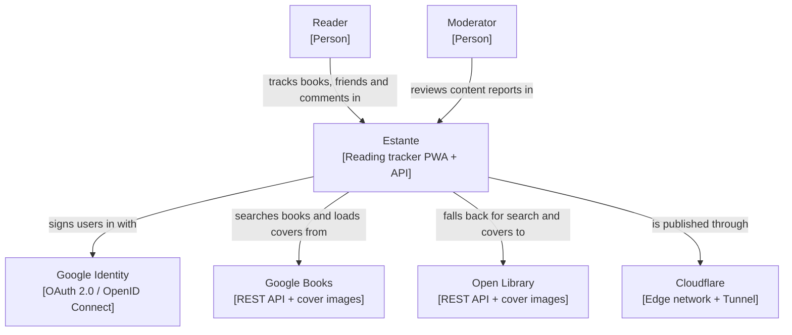
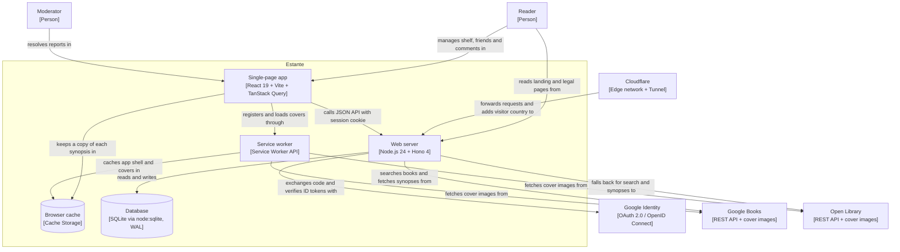
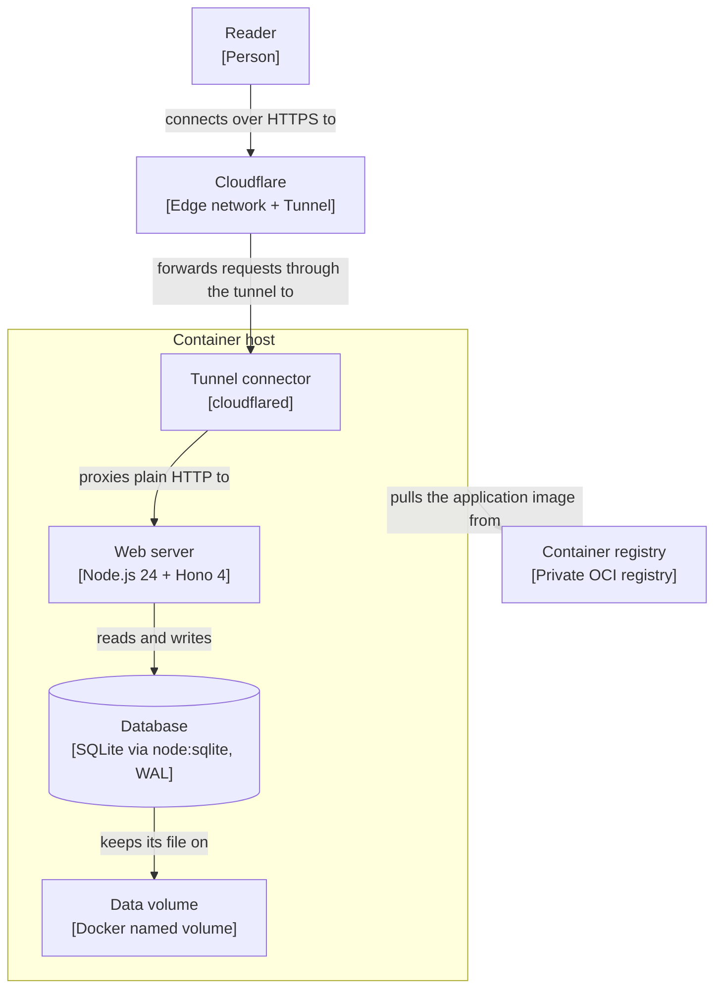
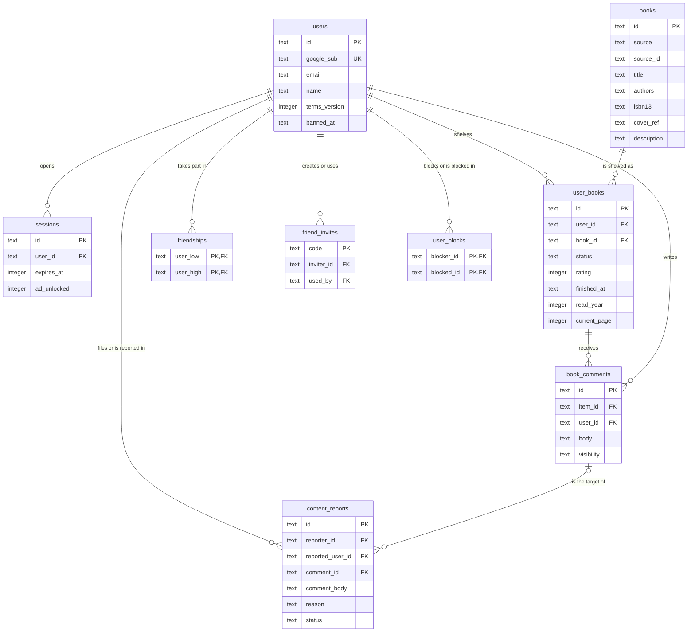
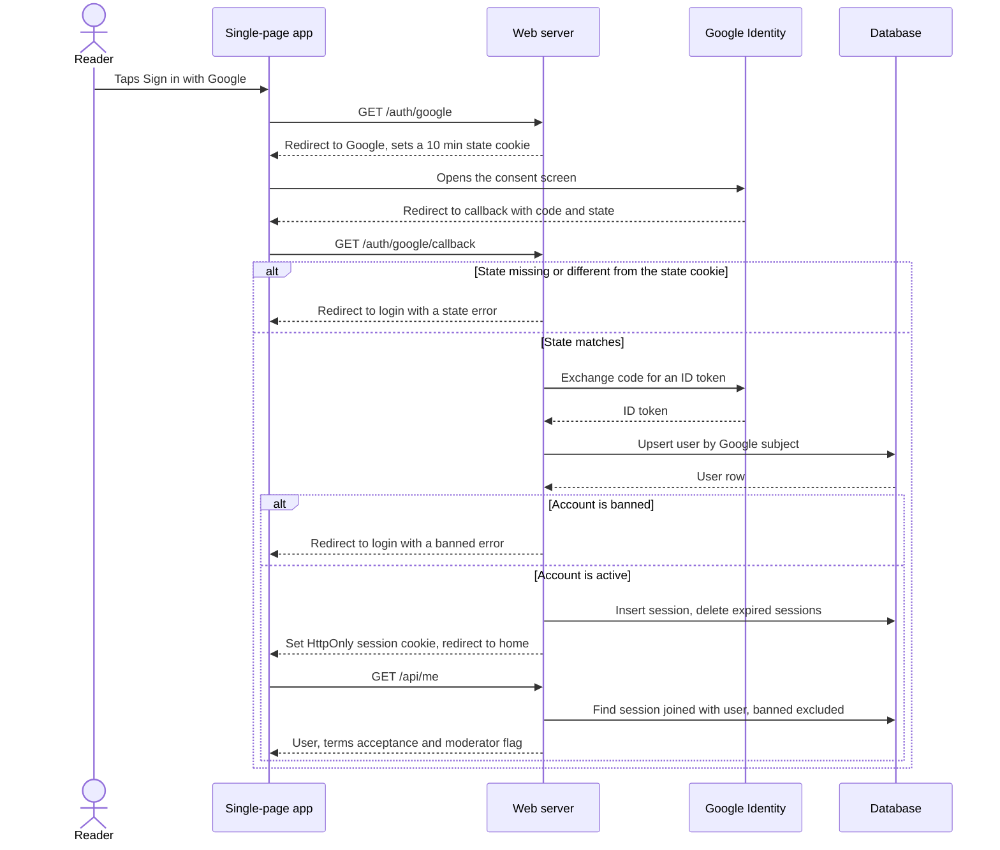
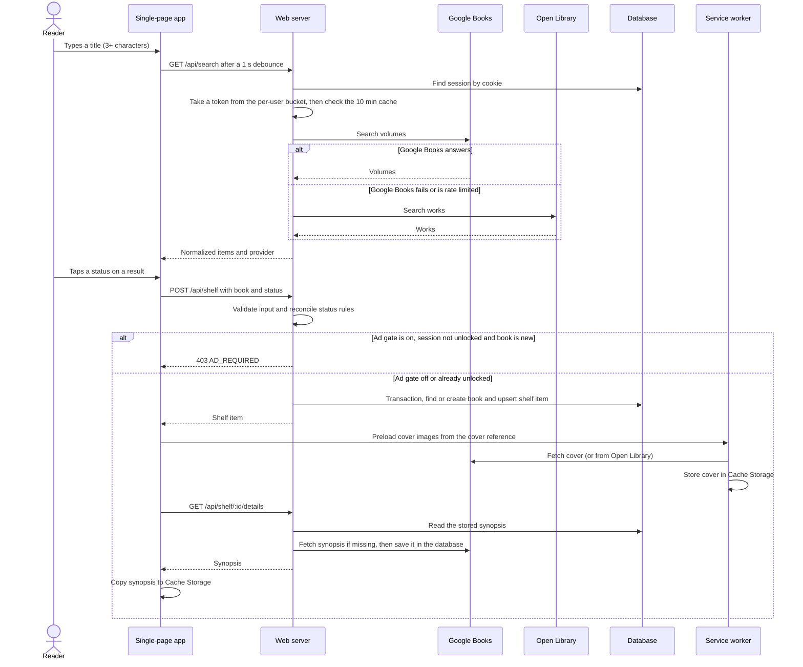

<!-- Generated by build.mjs from architecture.json and diagrams/*.mmd. Do not edit by hand. -->

# Estante — Architecture

> Generated from commit `2487705` on 2026-11-12 01:46 UTC. Sources: [`architecture.json`](architecture.json) and [`diagrams/`](diagrams/), which also hold the Portuguese version.

Estante is a mobile-first reading tracker: readers shelve books, rate and review them, add friends by invite link and exchange comments. It ships as one container published through a Cloudflare tunnel, with all state in a single SQLite file (D1, D2). Identity and the book catalog are delegated to Google and Open Library and nothing in the stack is paid for; what that costs is recorded in the decisions and risks.

**System type:** `web-app`

## Stack

| Technology | Role |
| --- | --- |
| TypeScript 7 | Language for client, server and tests |
| React 19 | UI of the single-page app |
| Vite 8 | Client build and dev server with API proxy |
| Tailwind CSS 4 | Styling |
| React Router 8 | Client-side routing |
| TanStack Query 5 | Server-state fetching and caching in the client |
| Node.js 24 | Server runtime |
| Hono 4 | HTTP framework for API, auth and server-rendered pages |
| SQLite (node:sqlite) | Embedded database in WAL mode, no native dependency |
| Google OAuth 2.0 / OpenID Connect | Reader sign-in, implemented without an auth library |
| Service Worker + Cache Storage | Offline app shell and on-device cache of covers and synopses |
| node:test | API tests against an in-memory database |
| Docker + Docker Compose | Multi-stage image and the single-container deployment |
| Cloudflare Tunnel | Public entry point in front of the container |
| GitHub Actions | CI: typecheck, tests and build |

## System context

Estante, its two kinds of users and the four external services it depends on.

Top-down flowchart. A reader and a moderator both use the Estante system. Estante signs users in with Google Identity, searches books and loads covers from Google Books, falls back to Open Library for search and covers, and is published through Cloudflare.

**Insight:** The system owns only reading data. Identity, the book catalog and the public entry point belong to third parties, and each of the four is named in the privacy policy.

## Containers

Two containers and a cache in the browser, one process and one database file on the server.

Top-down flowchart with the Estante boundary as a subgraph holding the single-page app, the service worker, the browser cache, the web server and the database. The reader and the moderator use the single-page app; the reader also reads landing and legal pages from the web server. Cloudflare forwards requests to the web server and adds the visitor country. The app calls the JSON API with a session cookie, loads covers through the service worker and keeps a copy of each synopsis in the browser cache, where the service worker also stores the app shell and covers. The web server reads and writes the database, talks to Google Identity for sign-in and to Google Books and Open Library for search and synopses. The service worker fetches cover images directly from Google Books and Open Library.

**Insight:** Two paths leave the browser and they never cross: reading state goes to the server, images go straight to the public sources (D4). The browser cache holds only copies, so clearing it loses nothing.

## Deployment

From the reader's browser to the database file: edge, tunnel, one container and one volume.

Top-down flowchart. The reader connects over HTTPS to Cloudflare, which forwards requests through a tunnel to the tunnel connector. The connector runs inside the container host, next to the web server, and proxies plain HTTP to it. The web server reads and writes the database, which keeps its file on a data volume. The container host pulls the application image from a private container registry.

**Insight:** The public path is the tunnel, which the connector opens from the inside, so the app needs no public inbound port. Everything below the edge exists exactly once, so the host, the container and the volume are each a single point of failure.

## Data model

The nine SQLite tables; the column selection is partial, showing keys and the fields that carry rules.

Entity-relationship diagram. A user opens many sessions and shelves many user_books; each user_books row points to one book, so books are shared between users. A shelf item receives many book_comments, each written by a user. Users take part in friendships, create or use friend_invites, appear in user_blocks as blocker or blocked, and appear in content_reports as reporter or reported; a report may also target a book comment.

**Insight:** The catalog (books) is shared and the reading state (user_books) is personal, which lets the 'friends who read this' badge match on the same book row or ISBN. A report keeps a copy of the comment text, so it outlives the removal of the comment.

## Sign in with Google

The highest-risk flow: hand-written OAuth, with the two failure paths that stop a sign-in.

Sequence diagram. The reader taps Sign in with Google; the app requests the sign-in route and the web server redirects to Google after setting a short-lived state cookie. Google redirects back to the callback with a code and the state. If the state is missing or differs from the cookie, the server redirects to the login screen with an error. Otherwise it exchanges the code for an ID token and upserts the user in the database. A banned account is redirected to the login screen with an error; an active one gets a new session row, an HttpOnly session cookie and a redirect to the home. The app then asks who is signed in, and the server finds the session joined with the user, excluding banned accounts.

**Insight:** A ban is enforced twice: once at sign-in and again on every request, because the session lookup joins the user row. That immediate revocation is what the per-request database read of D3 buys.

## Search and add a book

The central flow, from typing a title to the book on the shelf with its cover and synopsis cached.

Sequence diagram. The reader types a title; after a one-second debounce the app calls the search route. The web server finds the session, takes a token from the per-user bucket and checks the ten-minute cache, then searches Google Books; if that fails or is rate limited it searches Open Library instead. Normalized items return to the app. The reader taps a status and the app posts the book to the shelf route, where the server validates the input and reconciles the status rules. If the ad gate is on, the session has not unlocked it and the book is new, the server answers 403. Otherwise it finds or creates the book and upserts the shelf item in one transaction. The app then preloads the cover images through the service worker, which fetches them from the public source and stores them in Cache Storage, and asks for the synopsis: the server reads the stored one, fetches it from the source if missing and saves it in the database, and the app copies it to Cache Storage.

**Insight:** The synopsis is fetched from the source once per book, for every reader: the database holds the durable copy, the server memory and the browser hold disposable ones. The cover takes the opposite route and is never stored on the server.

## Elements

| Id | Kind | Name | Technology | Responsibility | Evidence |
| --- | --- | --- | --- | --- | --- |
| `reader` | person | Reader | — | Signs in with Google, keeps a shelf of books with status, rating and review, adds friends by invite link and writes private or public comments. | `client/src/pages/Login.tsx:64` |
| `moderator` | person | Moderator | — | A reader whose verified e-mail is on a list kept in code (D7); reviews content reports and can dismiss them, remove a comment or ban an account. | `server/moderators.ts:7` |
| `estante` | system | Estante | React PWA + Node.js API | Mobile-first reading tracker: shelf, ratings, reviews, history by year, friends, comments and moderation. | `server/app.ts:27` |
| `spa` | container | Single-page app | React 19 + Vite + React Router + TanStack Query | Installable PWA with the screens for shelf, search, book detail, years, friends, profile and moderation; talks to the server only through the same-origin JSON API. | `client/src/main.tsx:13` `client/public/manifest.webmanifest:8` |
| `service_worker` | container | Service worker | Service Worker API | Registered only in production builds. Caches hashed assets cache-first, serves navigation network-first with an offline fallback, and fetches and caches cover images, revalidating them after 30 days, except Open Library covers addressed by cover id, which never change. | `client/public/sw.js:63` `client/src/main.tsx:19` |
| `browser_cache` | database | Browser cache | Cache Storage | Per-device caches for the app shell, up to 300 cover images and a copy of each synopsis; cover and synopsis caches are cleared on sign-out. | `client/public/sw.js:8` `client/src/lib/bookCache.ts:6` `client/src/lib/bookCache.ts:55` |
| `web_server` | container | Web server | Node.js 24 + Hono 4 | The only server process (D1): JSON API, Google sign-in and cookie sessions, localized landing and legal pages, SEO files and the built SPA. Also holds the in-memory search cache, synopsis cache and rate limiter (D5). | `server/index.ts:24` `Dockerfile:22` |
| `sqlite_db` | database | Database | SQLite via node:sqlite (WAL) | One file with users, sessions, the shared book catalog and its synopses, shelf items, comments, friendships, invites, blocks and content reports; schema and migrations run at startup (D2). | `server/db.ts:6` `server/db.ts:142` |
| `google_identity` | external | Google Identity | OAuth 2.0 / OpenID Connect | Authenticates readers through the authorization-code flow; the only sign-in method in production. | `server/auth.ts:109` |
| `google_books` | external | Google Books | REST API + cover images | Primary source for book search and synopses; serves cover images straight to the browser, sometimes redirecting to a Google content host that the content security policy also allows. | `server/routes/search.ts:12` `server/app.ts:35` |
| `open_library` | external | Open Library | REST API + cover images | Fallback source for search and synopses; serves covers by cover id or ISBN, which may redirect to Internet Archive hosts that the content security policy also allows. | `server/routes/search.ts:13` `server/app.ts:35` |
| `cloudflare` | external | Cloudflare | Edge network + Tunnel | Public entry point: receives every browser request, forwards it through a tunnel and adds the visitor-country header used in language negotiation. Named in the privacy policy as a processor of IP address and country. | `server/legalText.ts:130` |
| `tunnel_connector` | infrastructure | Tunnel connector | cloudflared | Outbound tunnel client on the same Docker network as the app; receives requests from the Cloudflare edge and proxies them to the web server, so the app needs no public inbound port. It is deployed as a separate stack, outside this repository. | `deploy/compose.prod.yaml:21` |
| `container_host` | infrastructure | Container host | Docker Compose | Runs the application container with a restart policy and a health check, on a network shared with the tunnel connector. | `deploy/compose.prod.yaml:6` `Dockerfile:20` |
| `data_volume` | infrastructure | Data volume | Docker named volume | Named volume mounted at the data directory; the only persistent state of the deployment. | `Dockerfile:19` `deploy/compose.prod.yaml:20` |
| `container_registry` | infrastructure | Container registry | Private OCI registry | Stores the application image, tagged by commit and as latest; the production stack pulls from it instead of building. | `deploy/publish.sh:15` |

## Relationships

| From | To | Label | Protocol | Evidence |
| --- | --- | --- | --- | --- |
| `reader` | `estante` | tracks books, friends and comments in | HTTPS | `server/app.ts:66` |
| `moderator` | `estante` | reviews content reports in | HTTPS | `server/routes/moderation.ts:61` |
| `estante` | `google_identity` | signs users in with | OAuth 2.0 / OpenID Connect over HTTPS | `server/auth.ts:158` |
| `estante` | `google_books` | searches books and loads covers from | HTTPS | `server/routes/search.ts:88` |
| `estante` | `open_library` | falls back for search and covers to | HTTPS | `server/routes/search.ts:122` |
| `estante` | `cloudflare` | is published through | Cloudflare Tunnel | `deploy/compose.prod.yaml:24` |
| `reader` | `spa` | manages shelf, friends and comments in | Browser / installed PWA | `client/src/App.tsx:54` |
| `moderator` | `spa` | resolves reports in | Browser / installed PWA | `client/src/lib/api.ts:85` |
| `reader` | `web_server` | reads landing and legal pages from | HTTPS (server-rendered HTML) | `server/html.ts:34` `server/routes/legal.ts:15` |
| `cloudflare` | `web_server` | forwards requests and adds visitor country to | HTTP via tunnel | `server/localeResponse.ts:15` |
| `spa` | `web_server` | calls JSON API with session cookie | HTTPS / JSON | `client/src/lib/api.ts:24` `server/app.ts:64` |
| `spa` | `service_worker` | registers and loads covers through | Service Worker fetch interception | `client/src/main.tsx:20` `client/public/sw.js:67` |
| `spa` | `browser_cache` | keeps a copy of each synopsis in | Cache Storage API | `client/src/lib/bookCache.ts:31` |
| `service_worker` | `browser_cache` | caches app shell and covers in | Cache Storage API | `client/public/sw.js:54` `client/public/sw.js:23` |
| `web_server` | `sqlite_db` | reads and writes | In-process SQL (node:sqlite) | `server/index.ts:10` |
| `web_server` | `google_identity` | exchanges code and verifies ID tokens with | OAuth 2.0 / OpenID Connect over HTTPS | `server/auth.ts:183` `server/auth.ts:136` |
| `web_server` | `google_books` | searches books and fetches synopses from | HTTPS / JSON | `server/routes/search.ts:91` `server/routes/search.ts:168` |
| `web_server` | `open_library` | falls back for search and synopses to | HTTPS / JSON | `server/routes/search.ts:141` `server/routes/search.ts:174` |
| `service_worker` | `google_books` | fetches cover images from | HTTPS (no-cors image fetch) | `client/public/sw.js:39` `client/src/lib/format.ts:41` |
| `service_worker` | `open_library` | fetches cover images from | HTTPS (CORS image fetch) | `client/public/sw.js:10` `client/src/lib/format.ts:43` |
| `reader` | `cloudflare` | connects over HTTPS to | HTTPS | `server/legalText.ts:130` |
| `cloudflare` | `tunnel_connector` | forwards requests through the tunnel to | Cloudflare Tunnel | `deploy/compose.prod.yaml:30` `deploy/compose.prod.yaml:31` |
| `tunnel_connector` | `web_server` | proxies plain HTTP to | HTTP | `deploy/compose.prod.yaml:21` |
| `sqlite_db` | `data_volume` | keeps its file on | Filesystem | `Dockerfile:11` |
| `container_host` | `container_registry` | pulls the application image from | OCI image pull | `deploy/compose.prod.yaml:5` |

## Design decisions

### D1 — One process serves everything

- **Context:** A product maintained by one person needs an API, sign-in, indexable public pages and an installable app, with no budget for operations.
- **Choice:** A single Hono process serves the JSON API, the OAuth routes, the server-rendered landing and legal pages and the built SPA: one image, one port, one health check.
- **Alternatives:** SPA on static hosting or a CDN, with the API as a separate service.
- **Trade-offs:** The parts cannot scale or be released independently. A restart takes everything down at once and empties the in-memory caches. Static assets are served by Node instead of the edge.
- **Revisit when:** Static traffic dominates the server load, or API and front end need different release cadences.
- **Evidence:** `server/index.ts:19`, `server/html.ts:36`

### D2 — Embedded SQLite instead of a database server

- **Context:** The data is small and relational, and the deployment has no database service to lean on.
- **Choice:** Node's built-in node:sqlite in WAL mode. The schema is created at startup and column-level migrations are detected by inspecting the tables.
- **Alternatives:** A managed PostgreSQL. / SQLite through a native driver.
- **Trade-offs:** Only one instance can run. Queries are synchronous and block the event loop. Migrations have no version table, so they cannot be reversed or audited. Backup is a file copy that nothing schedules.
- **Revisit when:** A second instance is needed, a slow query is felt by other requests, or a migration has to be reversible.
- **Evidence:** `server/db.ts:1`, `server/db.ts:153`

### D3 — Hand-written Google OAuth with server-side sessions

- **Context:** Sign-in is Google only, and moderation has to cut a reader's access immediately.
- **Choice:** The authorization-code flow is written directly against Google's endpoints. Sessions are random identifiers stored in the database behind an HttpOnly cookie.
- **Alternatives:** An authentication library. / Stateless JWT sessions.
- **Trade-offs:** Security-sensitive code is maintained in-house. Every authenticated request costs a database read. The web flow relies on the direct TLS channel to Google to trust the ID token instead of verifying its signature.
- **Revisit when:** A second identity provider is added, or the native sign-in endpoint gets a real client.
- **Evidence:** `server/auth.ts:176`, `server/auth.ts:50`

### D4 — Covers never touch the server

- **Context:** Covers are the heaviest asset of the product and belong to third parties.
- **Choice:** Each book stores only a short cover reference. The client derives the image URL and the service worker caches the image on the device.
- **Alternatives:** Storing the cover files on the server. / Proxying covers through the server.
- **Trade-offs:** The cover hosts see the reader's IP address. The content security policy has to allow them and their redirect targets. The Google response is opaque to the service worker, so an error can stay cached until the 30-day revalidation. A cover disappears if its source drops it.
- **Revisit when:** Missing covers become a complaint, or third-party requests from the client stop being acceptable.
- **Evidence:** `server/db.ts:40`, `client/src/lib/format.ts:38`

### D5 — Search quotas protected inside the process

- **Context:** Search depends on the free quotas of two external catalogs.
- **Choice:** A client debounce, a per-user token bucket, a ten-minute result cache and a fallback catalog, with the bucket and the cache held in process memory.
- **Alternatives:** A shared cache service such as Redis. / A paid search quota.
- **Trade-offs:** Cache and buckets are lost on every deploy and exist per instance. Fallback results come from a different catalog, so the same query can return different books.
- **Revisit when:** A second instance exists, or quota errors appear despite the cache.
- **Evidence:** `server/routes/search.ts:35`, `server/routes/search.ts:41`

### D6 — One root URL: landing for visitors, app for readers

- **Context:** The root URL has to be indexable for visitors and be the app for signed-in readers, in three languages.
- **Choice:** On the root path the server checks the session cookie and returns either a script-free landing page or the SPA shell, with the language negotiated on the server.
- **Alternatives:** A separate marketing site. / Server-side rendering of the whole app.
- **Trade-offs:** The HTML varies by cookie, language and visitor country, so it is sent as non-cacheable and the edge cannot serve it. Every visit to the root costs a session lookup.
- **Revisit when:** The landing needs edge caching or its own release cycle.
- **Evidence:** `server/html.ts:34`, `server/localeResponse.ts:26`, `server/localeResponse.ts:27`

### D7 — Moderators are a list in code

- **Context:** Public comments between friends require moderation, and there is a single moderator.
- **Choice:** Moderators are a list of e-mails in the source, matched against the e-mail Google declares verified. Moderation routes answer 404 to everyone else.
- **Alternatives:** A role column in the users table, with a screen to manage it.
- **Trade-offs:** Changing moderators requires a deploy. The model depends on the identity provider verifying the e-mail. A decision is not attributed to the moderator who took it.
- **Revisit when:** There is a second moderator.
- **Evidence:** `server/moderators.ts:5`, `server/routes/moderation.ts:55`

## Quality attributes

### Security

**In place**

- Content security policy limited to the app's own origin plus the cover hosts.
- CSRF middleware rejects cross-origin form submissions; the JSON API relies on the SameSite session cookie.
- Session cookie is HttpOnly and SameSite=Lax, and Secure when the base URL is HTTPS.
- The OAuth callback compares the state with a short-lived cookie.
- An e-mail is stored only when the identity provider declares it verified.
- Write routes validate their input before touching the database.

**Gaps**

- Rate limiting exists only on search.
- Moderation decisions are not attributed to a moderator.

Evidence: `server/app.ts:39`, `server/app.ts:56`, `server/auth.ts:36`, `server/auth.ts:181`, `server/auth.ts:130`, `server/validate.ts:44`

### Reliability

**In place**

- Calls to the book catalogs time out after eight seconds and fall back to the second catalog.
- Writes that span tables run in a transaction, and SQLite waits on a busy database instead of failing.
- The container has a health check and restarts unless stopped.

**Gaps**

- Calls to the identity provider have no timeout.
- No retry on external calls.
- The health check does not touch the database.
- A single instance: any restart is an outage.

Evidence: `server/routes/search.ts:54`, `server/db.ts:178`, `server/db.ts:145`, `Dockerfile:20`, `compose.yaml:6`

### Observability

**In place**

- A health endpoint.
- Unexpected errors in route handlers are written to standard output.
- A request logger, in development only.

**Gaps**

- No access log in production.
- No metrics, tracing or alerting.
- Logs are unstructured.

Evidence: `server/app.ts:58`, `server/routes/shelf.ts:102`, `server/app.ts:30`

### Performance

**In place**

- Hashed assets are served as immutable with a one-year cache.
- Search results and synopses are cached in server memory.
- Indexes cover the shelf by status and year and the friends badge by book and ISBN.
- Covers are cached on the device; those that can change are revalidated after 30 days.

**Gaps**

- Database queries are synchronous on the event loop (D2).
- HTML cannot be cached at the edge (D6).

Evidence: `server/html.ts:31`, `server/routes/search.ts:36`, `server/db.ts:62`, `server/db.ts:85`, `client/public/sw.js:9`

### Recoverability

**In place**

- All persistent state is confined to one named volume.
- Schema creation and migrations are idempotent and run at every startup.
- Images are tagged by commit, so a previous version can be redeployed.

**Gaps**

- No scheduled backup and no restore test.
- Migrations cannot be rolled back (D2).

Evidence: `deploy/compose.prod.yaml:20`, `server/db.ts:147`, `deploy/publish.sh:10`, `docs/PENDENCIAS.md:25`

## Risks

| Risk | Status | Note |
| --- | --- | --- |
| All state lives in one file on one volume, with no scheduled backup. | open | Losing the volume loses every account. A manual consistent-copy procedure exists, but nothing runs it. |
| One container on one self-hosted machine behind one tunnel. | open | A failure of the host, the tunnel or the container is a full outage. It follows from D1 and D2; the owner has not yet classified it as accepted. |
| Sign-in depends entirely on one identity provider. | accepted | There is no second provider. Thirty-day sessions soften a short outage for readers who are already signed in. |
| Search depends on free quotas of external catalogs. | mitigated | Mitigated by the layers of D5; if both catalogs fail, search is unavailable while the rest of the app keeps working. |
| Calls to the identity provider have no timeout. | open | A slow answer during sign-in holds the request open for as long as the runtime allows. |
| Moderation rests on one person and leaves no record of who decided. | accepted | Accepted while D7 holds. |

## Known limits

Confirmed in the code, but partial or switched off:

- Rewarded ads are only partly wired. The client can call the ad placement API and the server has the reward route, but the ad script is not in the page and the content security policy allows no ad host; only the simulated provider works end to end. The ad gate is off by default and the privacy policy states that no ads are shown, so turning the gate on, even simulated, would contradict that text.
- An Android app packaged as a Trusted Web Activity is planned: the digital asset links file exists but holds placeholder values, and there is no Android project in the repository.
- The server has a route that opens a session from a Google ID token sent by a native client, verified remotely, but no native client exists.
- The privacy policy says deleted data may remain in backups for a limited period, but no backup is scheduled and nothing enforces that period.

## Open hypotheses

Searched for and not confirmed, so kept out of the diagrams:

- TLS probably terminates at the Cloudflare edge. The repository shows only that the tunnel connector reaches the container over plain HTTP and that the privacy policy promises HTTPS; where the certificate lives is not stated anywhere.

## Glossary

| Term | Definition |
| --- | --- |
| ad gate | A switch that requires a reader to watch one rewarded ad per session before adding a new book. Editing and removing are never blocked. Off by default. |
| cover reference | A short marker stored with a book, from which the client derives the cover URL at Google Books or Open Library (D4). |
| synopsis | The book description. Its source is the external catalog; the durable copy is in the database, shared by all readers of that book; disposable copies live in server memory for an hour and in the browser cache. |
| state cookie | A ten-minute HttpOnly cookie holding the random value sent to the identity provider, compared on the callback to reject forged sign-in responses. |
| ID token | The signed OpenID Connect token in which Google states who the reader is and whether the e-mail is verified. |
| app shell | The minimal HTML, manifest and icon the service worker keeps so the app opens offline. |
| per-user bucket | The token bucket that limits each reader to a burst of five searches and one per second after that (D5). |
| landing | The static, script-free home page served to visitors without a session (D6). |
